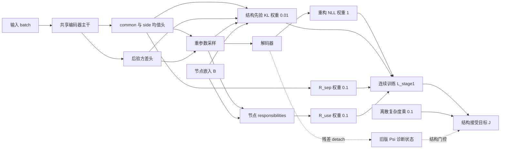
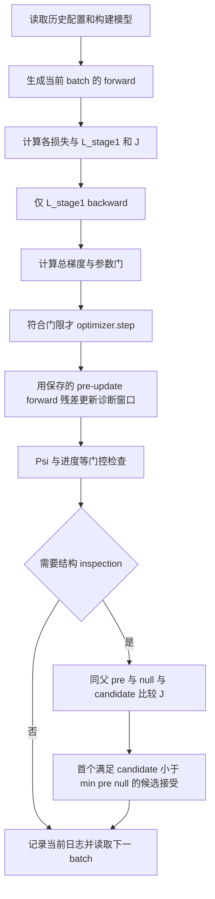

# Phase 0：真实损失函数盘点

审计编号：ML-P0-20261110。日期：2026-11-10。审计基线：`36167e30798afad4b6c68a1a65a7a5df2b8c773e`。

本轮仅静态读取源码、配置和已有记录，生成审计文档；未导入历史训练模块，未执行训练、smoke test、数据集下载或 checkpoint 反序列化。历史代码、配置和结果保持原字节。这里的“已定位/已核对”不代表科学验收或获准进入 Phase 1。

路径别名：`H/` = 本机 `~/Downloads/soma已有资料/soma_psi_code_handoff_20260903(1)/`；`U/` = `~/Downloads/soma已有资料/psi_xib_unified_20260824/`；`P/` = `~/Downloads/soma已有资料/psi_generalization/`；`HAM/` = 同一资料目录下的 `HAM/`。这些历史源码目前不在远端 main 中，引用为本次扫描文件的原始行号，关键文件 SHA-256 见 [信号审计](legacy_b_implementation_audit.md)。

## 结论与证据等级

不能确认“真实 SOMA 恰有三个共享参数损失”这一前提。不同历史入口具有不同目标：统一 Xi-B 被动 runner 为两个训练项；主动 SOMA 的已归档配置为四个启用项；HAM 生成器为五个项并另有判别器目标。不得从指南示例 0.5、10、0.02 推导损失名称或尺度。

证据分为：A = 当前文件中可直接追踪的计算/调用；B = 已有 CSV/JSON 的描述性记录；C = 文档说明；U = 未验证。B 级日志与源码计算相符，不构成当时执行 commit/hash 的完整溯源证明。本机两份 handoff 副本的对应文件一致，且资料 ZIP 中 85 个非 AppleDouble Python 文件均与解压目录一致；副本文件不代表独立实现，实际扫描计数见末尾范围说明。

## 1. 主动 SOMA：连续更新目标与结构接受目标

入口：`H/05_soma_psi_gated/scripts/run_controlled_stream_soma_psi.py`。损失组装：`soma/training/trainer.py:336–407`。连续训练和候选 warmup 分别在 `:298`、`:770` 对 `stage_one_objective` 反传；结构选择在 `:661–682` 比较 `total_objective`。

```text
L_stage1 = L_rec + beta_kl L_KL + lambda_dis L_dis
           + lambda_sep R_sep + lambda_use R_use
           + lambda_orth L_orth + lambda_sym L_sym
J_structure = L_stage1 + lambda_cmp C(structure)
```

`controlled_stream_soma_trigger_controls_nll_sigma01_randomseed_20260902.toml:45–64` 的历史配置为：重构 1、KL 0.01、分离 0.1、使用率 0.1；dis/orth/sym 均 0，symmetry disabled；复杂度权重 0.1。即四个非零系数的连续训练项，另加结构接受成本；某项当步恰为零不改变其配置身份。

已有 9 个运行、100 个 inspection 的 `reference_components` 满足上述四项加权恒等式，最大绝对误差 `4.91e-6`（只做已有数字核对）。但 runner 导入的 `_soma_configs`、`_build_mlp_soma` 所在文件缺失，故不能确认其所有配置覆盖和实际 MLP 参数命名；也不能仅凭 TOML 宣称整个入口可复现。

|原始项/位置，均相对 H/05_soma_psi_gated|定义与 reduction|身份及历史系数|梯度路径、detach 和边界|
|---|---|---|---|
|`reconstruction`；`soma/runtime/losses.py:15–37`|Gaussian NLL：batch 均值的像素求和 `Σ_j [0.5 log(2πσ²)+(x_j−xhat_j)²/(2σ²)]`；历史 σ=0.1。另支持 BCEWithLogits（同样像素求和）与缩放 MSE 分支|主任务重构，1|编码器→重参数采样→解码器；启用结构 readout 时也可达嵌入 B。该 loss 不 detach；Gaussian NLL 可合法为负。具体历史 MLP readout 路径因工厂缺件未验证|
|`kl`；`losses.py:40–52,107–128,194–203`|common 部分为 Monte Carlo `mean(log q(c|x)−log[(1/K)Σ_k N(c;center(B)_k,σ_c²I)])`；side 部分为对指定方差高斯先验的解析 KL，两者相加|潜变量先验约束，0.01|共用编码器后验均值/方差头；common prior 可达结构 B；不经过解码器。MC common 估计可为负；本次已读日志未见负 KL，不能据此保证所有未来 batch 非负|
|`separation`；`losses.py:55–74`|`R_sep = ||Cov(mu_c,mu_r)||_F² / clamp_min[(tr Cov_cc+eps)(tr Cov_rr+eps),eps]`；协方差以 `max(1,N−1)` 为分母|common/side 解耦，0.1|两个均值头及共享编码器；不经方差头或解码器；不 detach；非负，恒定输出时可为零，近零尺度靠 epsilon 处理|
|`usage`；同上|令 `pbar_k=mean responsibilities_k`，`a=rho_use/K`；`R_use=mean_k[(ReLU(a−pbar_k)/max(a,eps))²]`，rho=0.5|节点利用率约束，0.1|responsibilities 由 `z_c` 与中心化 B 距离 softmax 得出（`models/networks.py:165,190–194`）；可达 common 均值/方差头、编码器及 B，不经解码器；无 detach。K=1 时该罚项为零；其他情况下也常为零|
|`disentanglement`；`losses.py:77–104,215–271`|minibatch 对数密度估计的 `TC(c)+TC(r)+I(c;r)`；可设 dataset_size；`nan_to_num` 后按配置裁剪|可选解耦辅助项，当前历史配置 0；Python 默认 0.1、另一个 reference TOML 为 1，不能混为同一基线|均值/方差与采样分支共享编码器，不经解码器；没有整体 stop-gradient。有限 batch 估计可负；默认裁剪 ±100；NaN/Inf 被替换会掩盖原始异常，现有关闭分支的 0 不是测得原始值|
|`orthogonality`；`losses.py:131–143,206–212`|在最多 `jacobian_batch_limit` 个样本上取 `mean ||J_c J_r^T||_F²`|可选局部几何正交，历史系数 0|输入先 detach/clone，再 requires_grad；`autograd.grad(create_graph=True)` 保留对编码器参数的高阶路径。并非把模型梯度一并切断；不经解码器，空列表返回 0|
|`symmetry`；`losses.py:146–158`|变换前后 common 均值差平方和，加 side 均值与表示矩阵映射后的平方和，再平均|可选不变/等变辅助项，历史系数 0 且 transforms disabled|共享编码器、均值头；不经解码器；无损失 detach；无变换时为 0|
|`complexity`；`models/structure.py:49–59`|`C = 1*K + 0.25*effective_edges + 1*d_c`（该配置）；离散节点/维度与阈值边计数|结构选择成本，0.1；不在连续反传目标中|固定结构下没有可供 GradNorm 平衡的连续梯度；不能当作第五个共享训练任务|
|`reconstruction_mse`；`trainer.py:340`|全 batch、全像素平均平方误差|主任务诊断/评价，不是与 NLL 并列相加的额外损失|计算图存在不等于参与 backward；不能重复计入训练目标|

共享参数是“可达集合的交集”，不是全部模型参数。四个启用项的候选共同部分为编码器主干；解码器不是 KL/R_sep/R_use 的共同层，R_sep 也不依赖方差头。结构 B 由 `trainer.py:1113–1116` 单独加入优化器，邻接 W_A 被 detach。图上可达不保证实际梯度非零；特别是使用率饱和、K=1、ReLU 或对称性会产生零梯度。具体历史 MLP 的共同层名称仍需缺失工厂源码确认。

### 已有数值范围与梯度记录

下表只读 `runs/controlled_stream_soma_manual_nll_sigma01_randomseed_20260902/soma_logs/signal/seed_*/stream_train_history.csv`。每 seed 3000 行；数值为原始未乘权项，不作新实验或独立统计推断。

|seed|重构 NLL min / median / max|原始 KL min / median / max|MSE min / max|总梯度 EMA min / max|
|---|---|---|---|---|
|854007|-56.9107 / -22.7066 / 30.0603|23.6924 / 54.6053 / 157.418|0.00988834 / 0.0370668|3.22515 / 66.3893|
|891047466|-64.0356 / -30.2342 / 35.6059|22.1243 / 79.2363 / 229.629|0.00766181 / 0.0387998|3.84626 / 76.6362|
|995002589|-61.9024 / -24.7306 / 33.0844|27.0999 / 55.9227 / 145.394|0.00832842 / 0.0380118|3.40762 / 76.7269|

此外，33 个 signal inspection 的 parent-eval 记录给出：`R_sep` 为 `9.2911e-7–0.932558`，`R_use` 为 `0–5.5690e-5`、其中 32 个为零；`C` 为 `2–4.75`，加权成本 `0.2–0.475`。这是候选比较数据上的稀疏评估范围，不是逐训练 step 范围。逐步 CSV 没有 separation/usage 列，不能补造它们的训练曲线。关闭的 dis/orth/sym 在这 33 份记录中均为 0。

全部 9 份 CSV 共 27000 行的已记录总目标、重构、KL、总梯度 EMA 和 Psi 列未发现 NaN/Inf；这不证明未记录分量或全部执行过程无异常。Gaussian NLL 与 `64*(MSE/(2*0.1²)+0.5*log(2π*0.1²))` 的最大误差为 `1.831e-5`，解释了负 NLL：它不是损坏日志。

每项损失的独立梯度范数、共同层梯度与两两余弦均未记录，全部标为 **U/未测**；`gradient_norm_ema` 是混合目标所有被优化参数梯度的 EMA，不是每项范数。Phase 0 没有前向或 autograd 测量，不能从现有量推断持续梯度冲突。

## 2. 旧版统一 Xi-B 被动训练

`H/03_psi_xib_unified/train_xib_unified.py:299–307,436–481`：

```text
objective = rec_loss + beta_kl * KL_standard_normal
beta_kl 默认 0.001
KL = mean_batch[-0.5 * sum_latent(1+logvar−mu²−exp(logvar))]
```

controlled 直接对原始输出做全元素 MSE；dSprites 为 BCEWithLogits；Shapes3D/CIFAR 为 sigmoid 输出的 MSE，尽管配置标签为 gaussian，这里没有主动 SOMA 的带常数 Gaussian NLL。定义位于 `03/models.py:65–80`。两个主模型项共享编码器；KL 不经过解码器，重构经重参数采样回传。无模型 loss detach；后验 logvar 被裁剪至 ±12。均为非负理论项、KL 可为零；本机没有该入口的原始 train_history/resolved_args/checkpoint，典型数值和逐项梯度为 U，CLI 默认不能替代历史 resolved_args。

probe 的交叉熵在 `:337–388` 更新独立线性分类器，特征在 `:310–324` 的 no_grad 中提取；它不回传主 VAE，不是第三个联合训练项。主模型固定训练预算后保存终态，并未使用验证集选择主模型最佳 checkpoint。`U/` 下同名 runner 也是重构+KL；不能仅因文件同名就混同哈希或信号输出字段。

## 3. 其他历史分支及防止误归类

|入口/定义|实际项、系数及共享关系|证据边界|
|---|---|---|
|`H/01_spectral_signals_abc/run_pw_signal_experiment.py:1213–1225`；`models.py:153–159`|默认 `loss_only` 是 MSE + 0.001 KL。`loss_plus_xi` 另外加 `lambda_xi*xi`；CLI lambda 默认 1，compact grid 默认 0.001，必须分别追踪运行参数。`losses_pw.py:578–652` 保留当前 batch 的可反传谱路径，历史窗口和白化矩阵 detach|存在真实可反传 Xi 选项，不能用于本任务“B 仅监测”的训练。没有相应运行实参时不宣称此选项实际跑过；不执行吸收性临时适配或信息分类器训练|
|`H/04_i1_i4_residual_interventions/run_pw_signal_experiment.py` 的父训练；`run_i1_i4_residual_interventions.py`|父脚本同族，仍有 `loss_plus_xi` 选项；离线 I1–I4 runner 本身不反传训练损失。不能把离线干预差值作为额外训练任务|离线统计、父训练与 B 诊断分开。父残差 chunk/完整白化状态未取得，无法重放|
|`H/02_dataset_generalization_xi/train_dataset_generalization.py:214–219`|BCE/MSE 重构 + beta KL；probe CE 只更新分类器；MultiSpectralXi 监测 edge/mass/gap|不是三个训练损失。训练与独立探针参数分开|
|`P/train_psi_generalization.py:126–132,334–346`、`models.py:65–80`|BCE/MSE + 默认 0.001 KL，另有 readout warmup 与独立 probe CE；固定白化/经验 edge 信号，不是本任务目标旧版实现|不把新近固定参考分支当旧 EMA runner；本机未见其运行日志，典型范围/逐项梯度 U|
|`H/05.../soma/experiments/vae_baselines.py:107–168`|VAE/beta-VAE 的 rec+beta KL；FactorVAE 再加 gamma*TC（两判别器 logits 均值差，默认 gamma=10）；DIP 再加 dip_lambda*(offdiag Cov(mu) 平方和 + 对角偏离 1 平方和)，默认 1；判别器两组 CE 由独立优化器训练，latent detach。Ada-GVAE 命名分支实际 beta=`1+int(batch>1)`|这些是基线代码路径，非主动 SOMA 当前启用项；TC 估计可负。名称不证明实现等于权威论文完整算法；无运行日志不报告性能或尺度|
|`HAM/ham_trainer.py:249–294`；`HAM/losses.py:90–156`|每节点 `F_u = 10*MSE + w_KL*KL + 5*inv + 5*eqv + 5*softplus(D(z)).mean()`；先逐样本取节点最小值，再 batch 均值。`w_KL` 在 epoch<10 为 0，随后直接为 0.01（不是注释所说的渐增）。KL 和 TC 是 batch 标量，广播入每样本节点能量；只让胜出路径回传。判别器另用 `0.5*(BCE_joint+BCE_permuted)`|五个生成器项，共享视觉编码器及节点 heads；重构经 decoder，其他项不共享完整 decoder。D 步特征与 latent no_grad/detach，生成器 TC 步的 D 没有 freeze/detach，但 D 不在 G 优化器中，需未来专门核对梯度累积语义。原始训练标量日志缺失，范围/逐项梯度 U|
|`HAM/pretrain.py:95–110`；`HAM/ham_trainer.py:439–460`|预训练仅均值 latent 的 MSE；结构候选 warmup 只含 rec+KL+inv+eqv，省略 TC；`HAM/evaluator.py:375,408–420` 以 delta_F+lambda_cmp delta_C 评估|预训练、生成器主训练、候选 warmup/评价目标不相同，不能拼成一个固定“三损失”任务|
|仓库 `scripts/run_b_development.py:60–64`|开发 fixture 为 MSE+beta KL；这里 KL 对 batch 和 latent 全部平均，旧 runner 是 latent 求和再 batch 平均|使用的是新版 B，development-only；不作为历史多损失基线。本轮未运行|

## 4. 损失依赖图

以下图描述可读到的 SOMAModel/Trainer 通用路径；缺失的历史 MLP 工厂未被臆造。



## 5. 原训练流程图



这是 `05` 通用源码流程，不是本轮运行记录。`03` 则无结构编辑门：forward→rec+KL backward/step→从保存的 pre-update 输出 detach 残差→`XiBSignal.update_and_measure`→日志和独立 probe。日志调用位于 step 后，不代表使用更新后重新预测的残差。

## 6. 进入下一阶段前的限制

负 NLL 不能直接放入未论证的相对速度归一化/Uncertainty 公式；`abs()`、静默平移或把 NLL 换 MSE 都会改变含义。R_use 的大量零值使初值归一化和梯度比率也需负责人先明确处理。应先确定选用 `03`、`05` 还是 HAM 的真实基线和损失清单，再冻结共同层、原权重、验证目标与数据角色。详见 [阻塞报告](phase0_blockers.md)。本轮不适配算法、不创建控制器、不做梯度实验。

## 7. 扫描范围

当前 main 全部 Python 文件，以及可见历史资料目录的 85 个 Python 文件已静态检索；历史 85 个均可 AST 解析，73 个不同字节内容。另一个独立 handoff 副本包含 56 个 Python 文件，与对应目录一致；合计 141 个文件记录不作 141 个独立实现计数。已扫描 9 个主动运行 27000 行逐步 CSV、100 个有组件的结构 inspection；没有运行任何历史代码。部分缺件见另外三份审计文档。
